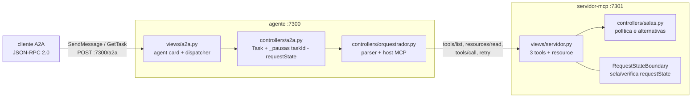

# A Ponte — um agente A2A com MCP por dentro

Entrega do desafio inicial do curso de MCP e A2A (MBA Engenharia de Software com IA).
Dois processos separados: um **servidor MCP** que expõe o domínio das salas e um **agente** que é
host MCP por dentro e servidor A2A v1.0 por fora. A costura entre os dois protocolos — o
`input_required` do MCP virando `TASK_STATE_INPUT_REQUIRED` da Task — é o que este repositório
resolve.

Domínio: cinco salas de reunião da Hill Valley Tech (`dados/salas.json`), reservas iniciais
(`dados/reservas.json`) e a política de uso (`dados/politica-de-uso.md`, versão `2026-11-01`).
Sem LLM no caminho de execução: a interpretação do pedido é por regra, e a mesma entrada produz
sempre a mesma saída.

## Arquitetura



A Task do A2A e o `requestState` do MCP são os dois únicos estados que atravessam a fronteira, e
ambos viajam **explicitamente**: a Task tem identidade (`id`, `contextId`) e o `requestState` é um
token selado que o cliente devolve no retry. Nenhum dos dois protocolos tem sessão.

## Como rodar

Requisitos: Python 3.10+ (testado em 3.12 e 3.14), `uv` e `git`. Nenhuma dependência de LLM.

### Passo 1 — clonar e criar o ambiente (uma vez)

```bash
git clone https://github.com/thuurzz/desafio-a2a-com-mcp.git
cd desafio-a2a-com-mcp

# 1. ambiente e dependência (SDK oficial do MCP v2)
uv venv .venv
uv pip install --python .venv/bin/python 'mcp==2.3.0'

# 2. pacotes do agente (models/, controllers/, views/) em modo editável
uv pip install --python .venv/bin/python -e agente
```

### Passo 2 — criar a chave do `requestState` (uma vez)

O servidor MCP **não sobe** sem `REQUEST_STATE_SECRET`. Ela não é chave de API: é o segredo com que o
`requestState` é cifrado. Gere uma e **guarde** — usar a mesma em cada subida é o que faz um
`requestState` emitido antes de um restart continuar válido depois dele.

```bash
# gera e salva num arquivo local, fora do git
python3 -c 'import secrets; print(secrets.token_hex(32))' > .request_state_secret
chmod 600 .request_state_secret
```

O `.gitignore` do repositório já cobre `.request_state_secret`, `.env`, `.venv/` e `*.egg-info/`. Se você
usar outro nome de arquivo para a chave, confira que ele não vai ser commitado.

> **Atenção — a variável existe só no terminal onde foi exportada.** Um `export` não atravessa terminais.
> Se você subir o servidor MCP em um terminal e o agente em outro (é o recomendado, porque cada um
> imprime log na própria tela), **cada terminal precisa do seu próprio `export`**. Esquecer isso é o
> erro mais comum: o servidor MCP responde `Erro: REQUEST_STATE_SECRET ausente ou com menos de 32 bytes`
> e encerra antes de escutar na porta.

### Passo 3 — subir os dois processos (opção A: dois terminais, recomendada)

```bash
# ---------- terminal 1: servidor MCP (porta 7301, endpoint /mcp) ----------
cd desafio-a2a-com-mcp
export REQUEST_STATE_SECRET="$(cat .request_state_secret)"   # <-- obrigatório NESTE terminal
.venv/bin/python servidor-mcp/main.py

# ---------- terminal 2: agente A2A (porta 7300) ----------
cd desafio-a2a-com-mcp
export REQUEST_STATE_SECRET="$(cat .request_state_secret)"   # <-- obrigatório NESTE terminal também
.venv/bin/python agente/servidor.py
```

O agente não usa o segredo para nada; o `export` nele está ali só para o caso de você trocar os
processos de terminal sem perceber. O que **não** pode faltar é o do terminal 1.

### Passo 3 (opção B: um terminal só)

Se preferir um terminal único, o `export` vale para os dois porque vêm do mesmo shell:

```bash
cd desafio-a2a-com-mcp
export REQUEST_STATE_SECRET="$(cat .request_state_secret)"   # vale para os dois processos abaixo
.venv/bin/python agente/servidor.py > /tmp/agente.log 2>&1 &
.venv/bin/python servidor-mcp/main.py                # fica em primeiro plano; Ctrl+C encerra só ele
```

Para derrubar os dois: `pkill -f 'agente/servidor.py'` no outro terminal, ou
`kill %1` se o job ainda estiver no mesmo shell.

### Passo 4 — conferir e rodar o validador

```bash
# card publicado
curl -s http://localhost:7300/.well-known/agent-card.json | python3 -m json.tool

# validador oficial (os dois processos precisam estar recém-iniciados)
.venv/bin/python validador/validar.py --agente http://localhost:7300 --mcp http://localhost:7301
```

O validador muta o estado em memória. Se rodar ele duas vezes seguidas no mesmo par de processos,
verificações que dependem de salas livres falham — reinicie os dois antes de medir de novo.

### Atalho: tudo de uma vez, em portas isoladas

`./scripts/progresso.sh` sobe os dois processos do zero em `7391`/`7390`, com a chave gerada na hora,
roda o validador e derruba tudo no final. Não precisa de `export` nem de terminal extra:

```bash
./scripts/progresso.sh
```

Portas e caminhos são parametrizáveis: `MCP_PORT`/`MCP_PATH` no servidor MCP, `A2A_PORT`/`A2A_HOST`
no agente, `MCP_URL` no cliente do agente.

### Exemplo de uso (A2A na mão)

```bash
# pedido de reserva (formato fixo, sem linguagem natural)
curl -s -X POST http://localhost:7300/a2a -H 'Content-Type: application/json' \
  -H 'traceparent: 00-4bf92f3577b34da6a3ce929d0e0e4736-00f067aa0ba902b7-01' \
  -d '{"jsonrpc":"2.0","id":1,"method":"SendMessage","params":{"message":{"messageId":"msg-1","role":"ROLE_USER","parts":[{"text":"reservar sala=sala-garagem inicio=2026-11-03T14:00:00-03:00 fim=2026-11-03T15:00:00-03:00 responsavel=Marty"}]}}}'
```

A resposta vem com `status.state = TASK_STATE_INPUT_REQUIRED` e a mensagem
`alternativas: sala-fusca, sala-mirante`. A continuação usa o `id` da Task:

```bash
curl -s -X POST http://localhost:7300/a2a -H 'Content-Type: application/json' \
  -d '{"jsonrpc":"2.0","id":2,"method":"SendMessage","params":{"message":{"messageId":"msg-2","role":"ROLE_USER","taskId":"<taskId>","parts":[{"text":"escolha=sala-fusca"}]}}}'
```

`escolha=recusar` termina a Task em `TASK_STATE_CANCELED`. `GetTask` com `{"id":"<taskId>"}`
devolve o estado corrente, o histórico e o artifact.

## Onde a ponte acontece

O `input_required` do MCP vira pausa da Task em **`agente/controllers/a2a.py`**: a tradução de
resultado mapeia `Pausado` para `EstadoTask.INPUT_REQUIRED` e monta a mensagem exata
`alternativas: <ids>` (na ordem do `enum`), enquanto `self._pausas[taskId] = pausado` guarda o
`requestState` amarrado àquela Task — o registro nunca é serializado em resposta A2A.

O `requestState` volta para o servidor em **`agente/views/cliente.py`**: no retry, `call_tool` recebe
`input_responses` com a mesma chave que veio no `inputRequests` e `request_state` ecoado byte a byte,
e o SDK gera um **id JSON-RPC novo** para esse request (requisito da spec; o id inicial não pode ser
reaproveitado).

Do lado do servidor, o token é selado e verificado em **`servidor-mcp/views/app.py`**, que registra
`RequestStateBoundary(RequestStateSecurity(keys=[REQUEST_STATE_SECRET], ttl=900))` no
`Server.middleware`: o handler devolve o estado em texto claro e o boundary cifra; no retry, o
boundary verifica e abre antes do handler, e responde `-32602` quando o token foi adulterado, expirou,
mudou de método ou veio com argumentos diferentes dos selados.

## Decisões técnicas

- **`requestState`: AES-256-GCM do próprio SDK (`RequestStateSecurity`), TTL de 15 minutos.**
  Assinar seria suficiente para integridade, mas o codec embutido também cifra, e a chave vem de
  `REQUEST_STATE_SECRET` (variável de ambiente, mínimo 32 bytes, nenhum valor no código). O envelope
  carrega método, tool, digest dos argumentos, expiração e o payload — por isso um retry continua
  válido **depois de reiniciar o processo**, sem nenhum estado em memória no servidor.
- **Onde ficam as Tasks: memória do processo do agente.** `agente/controllers/a2a.py` mantém
  `dict[taskId] -> Task` e `dict[taskId] -> Pausado`. Não sobrevive a restart, o que o enunciado
  permite: só o `requestState` precisa sobreviver, e ele viaja no token.
- **Cliente MCP: SDK oficial com `allow_input_required=True`.** Essa flag faz `ClientSession.call_tool`
  devolver o `InputRequiredResult` cru em vez de rodar o driver de MRTR — que responderia a pergunta
  sozinho e evaporaria a pausa. Os headers `Mcp-Method`, `Mcp-Name` e `MCP-Protocol-Version` são
  montados pelo transporte do SDK a partir do corpo.
- **Servidor MCP stateless com `json_response=True`.** Sem sessão e sem inferir nada de request
  anterior; a resposta é JSON puro (o `Accept` do cliente inclui `application/json`), o que evita
  parsear SSE no cliente.
- **Erros de execução contra erros de protocolo.** Política violada, conflito sem alternativa e
  recusa são `isError` dentro de um resultado `complete` com a mensagem literal do enunciado;
  `_meta` incompleto, tool inexistente, URI desconhecida e `requestState` inválido são `error`
  JSON-RPC (`-32602`/`-32021`), com HTTP 400 nos casos que o enunciado exige.
- **Regra de negócio só no controller.** `servidor-mcp/controllers/salas.py` decide janela, duração,
  sobreposição e alternativas (máximo três, capacidade crescente, empate por id). O agente apenas
  traduz protocolo — não há regra de sala no lado A2A.
- **MCP fora do ar fecha a Task, não derruba o request.** O SDK do MCP roda o POST dentro de um
  task group do anyio: quando a conexão falha, o grupo cancela a task que espera a resposta e o que
  escapa no `await` é `CancelledError` — que herda de `BaseException` e, portanto, **não** é pego por
  `except Exception`. Sem tratamento, o handler morria e o cliente A2A recebia HTTP 500. O invólucro
  `_falar_com_mcp` em `agente/controllers/a2a.py` traduz o cancelamento em `Falhou` e consome o
  pedido com `Task.uncancel()`, então a resposta é 200 com a Task em `TASK_STATE_FAILED` e a
  mensagem `MCP indisponivel: ...`. Vale para os dois caminhos: abertura e continuação de pausa.

## Saída do validador

Execução real, com os dois processos recém-iniciados (`./scripts/progresso.sh`):

```
trace-id desta execucao: 51f065c7e8ace122791da1315aafa726

PASS 01 tools/list traz as tres tools
PASS 02 toda tool tem inputSchema de objeto
PASS 03 listar_salas devolve structuredContent e o mesmo JSON em texto
PASS 04 _meta sem protocolVersion devolve -32602 e HTTP 400
PASS 05 _meta sem clientCapabilities devolve -32602 e HTTP 400
PASS 06 tool inexistente e recusada, por -32602 ou por isError
PASS 07 resources/read de politica://uso devolve a politica
PASS 08 resources/read de URI inexistente devolve -32602
PASS 09 sala inexistente devolve isError com a mensagem exata
PASS 10 fora da janela devolve isError com a mensagem exata
PASS 11 duracao acima de 2h devolve isError com a mensagem exata
PASS 12 intervalo invertido devolve isError com a mensagem exata
PASS 13 conflito devolve input_required com inputRequests e requestState
PASS 14 a elicitation e form mode e oferece as alternativas na ordem certa
PASS 15 conflito sem a capability elicitation devolve -32021 e HTTP 400
PASS 16 retry com inputResponses e requestState conclui a reserva
PASS 17 requestState adulterado e rejeitado com -32602
PASS 18 argumentos adulterados no retry nao tomam efeito
PASS 19 recusa conclui sem reservar e sem isError
PASS 20 conflito sem alternativa possivel devolve isError com a mensagem exata
PASS 21 agent card responde 200 no well-known com JSON
PASS 22 o card declara a interface JSON-RPC com url e versao 1.0
PASS 23 o card declara a skill reservar-sala
PASS 24 SendMessage com sala livre conclui a Task
PASS 25 o artifact chama reserva e traz a versao da politica
PASS 26 GetTask devolve id, contextId e estado corrente
PASS 27 SendMessage com sala ocupada pausa a Task
PASS 28 a Task pausada lista as alternativas na ordem certa
PASS 29 escolha fora do enum mantem a Task pausada
PASS 30 a continuacao conclui a Task na sala escolhida
PASS 31 SendMessage em Task terminal e recusado
PASS 32 a recusa termina a Task em CANCELED
PASS 33 duas Tasks pausadas ao mesmo tempo concluem cada uma com a sua reserva
PASS 34 nenhuma resposta A2A carrega o requestState
PASS 35 sala inexistente termina a Task em FAILED com a mensagem da tool
PASS 36 o agente e deterministico: o mesmo pedido produz a mesma pausa

resumo: 36 passaram, 0 falharam, de 36 verificacoes
```

`exit=0`. O validador muta o estado em memória, então rode sempre com processos novos — rodar duas
vezes seguidas no mesmo processo derruba as verificações que dependem de salas livres.

O stderr do servidor MCP mostra, por request, método, id e `traceparent`:

```
mcp request metodo=tools/list id=2 traceparent=00-51f065c7e8ace122791da1315aafa726-652edfbb2b05ca8a-01
mcp request metodo=resources/read id=3 traceparent=00-51f065c7e8ace122791da1315aafa726-77144a9cf8c02420-01
mcp request metodo=tools/call id=4 traceparent=00-51f065c7e8ace122791da1315aafa726-b3408a05f890d904-01
```

Trace-id do cliente A2A preservado, span-id novo por request, `tools/list` antes do primeiro
`tools/call`.

## Estrutura

```
.
├── README.md                      esta documentação
├── dados/                         domínio (não alterar)
├── validador/                     36 verificações de conformidade (não alterar)
├── exemplos/wire/                 pares request/response dos dois protocolos (não alterar)
├── servidor-mcp/                  servidor MCP (Streamable HTTP, :7301)
│   ├── models/                    tipos e carga de dados/
│   ├── controllers/               política, conflitos e alternativas
│   └── views/                     handlers MCP, guard do _meta, boundary do requestState
├── agente/                        agente (A2A, :7300) + host MCP
│   ├── models/                    Pedido, resultados, Task
│   ├── controllers/               parser, orquestrador MCP, máquina de estados A2A
│   └── views/                     cliente MCP (SDK) e app A2A (Starlette)
├── scripts/                       progresso.sh
├── docs/                          notas por fase, roadmap e fatos do SDK
└── openspec/                      specs e changes (spec-driven development)
```

## Fora de escopo

Autenticação/OAuth, streaming, push notifications, refinamento de Task, prompts, subscriptions,
progress, persistência em disco das reservas, interface gráfica, containers e deploy. Nada disso é
necessário para o enunciado e nada disso foi implementado.

## Documentação de apoio

- `docs/roadmap.md` — as fases, o escopo de cada uma e a régua de progresso (verificações do validador).
- `docs/fase-1.md` … `docs/fase-5.md` — o que cada fase entregou, com as evidências reais.
- `docs/sdk-mcp-2.3.0.md` — fatos verificados da API do SDK `mcp` 2.3.0 usados no projeto.
- `docs/fix-mcp-fora.md` — o caso do MCP fora do ar: por que dava HTTP 500 e como a Task passa a
  fechar em `TASK_STATE_FAILED`.
- `openspec/changes/` — proposta, design, tasks e spec delta de cada fase.
