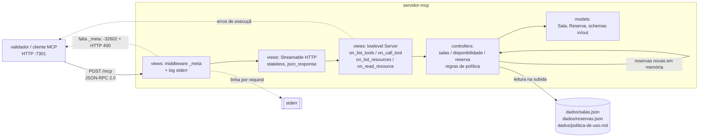
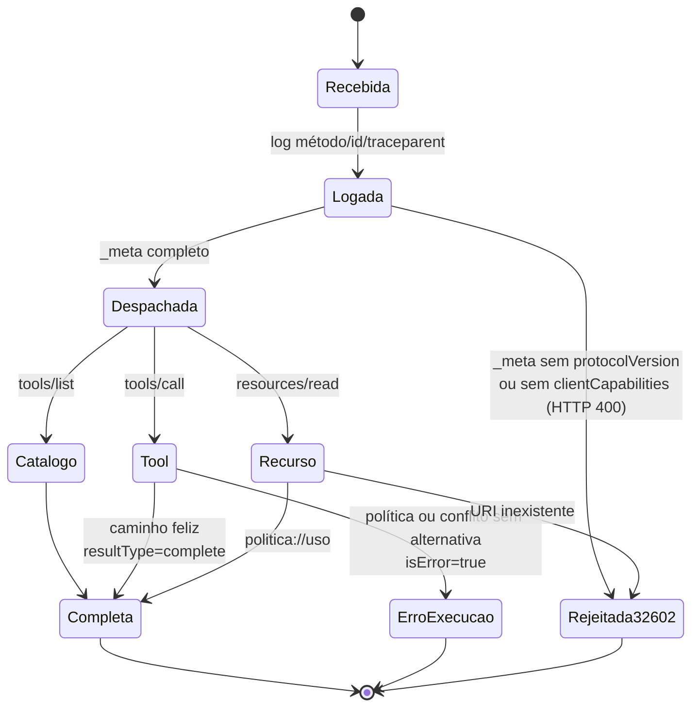

# Design

## Context

Ver `proposal.md` para motivação e escopo. O que condiciona o desenho:

- A fonte de verdade é o `README.md`, os pares de `exemplos/wire/01`–`05` e as verificações 01–12 de `validador/validar.py`. O validador fala HTTP direto com `http://localhost:7301/mcp`, envia `Content-Type: application/json`, `Accept: application/json, text/event-stream`, `MCP-Protocol-Version: 2026-07-28`, `Mcp-Method` e (em `tools/call`/`resources/read`) `Mcp-Name`, e faz `json.loads` no corpo da resposta.
- O SDK é o oficial `mcp>=2.3,<3` (v2). A API usada é a documentada em `docs-para-opencode.md`: lowlevel `Server` com `on_list_tools`/`on_call_tool`/`on_list_resources`/`on_read_resource` e `streamable_http_app(stateless_http=..., json_response=...)`. A v2 não tem mais `@server.list_tools()`/`@server.call_tool()`.
- `dados/`, `validador/` e `exemplos/` são somente leitura. Não há ORM, banco nem camada de serviços: as regras são funções puras sobre listas em memória.

## Goals / Non-Goals

**Goals:**

- Um processo Python único, stateless, que responde às verificações 01–12 com o formato exato dos exemplos de wire.
- Separar contrato (models), regra (controllers) e superfície de protocolo (views) para que a fase 2 (MRTR) acrescente `input_required`/`requestState` sem reescrever a regra de negócio.
- Deixar explícito, desde já, onde a fase 2 selará/verificará o `requestState` e onde a fase 3 pausará a Task.

**Non-Goals (de desenho):**

- Nenhuma negociação de capability além de validar presença no `_meta`; nenhuma sessão, nem em memória, nem via header.
- Nenhum middleware de elicitation, nenhuma assinatura nesta fase.
- Nenhum cliente MCP, nenhum A2A, nenhum código em `agente/`.

## Decisions

### D1. Lowlevel `Server` com handlers explícitos, não FastMCP

Usar `mcp.server.lowlevel.server.Server` com `on_list_tools`, `on_call_tool`, `on_list_resources` e `on_read_resource` permite controlar o `structuredContent`, o bloco de texto, o `outputSchema` e o `isError` exatamente como o validador exige. FastMCP esconde esses detalhes e amarra a assinatura dos handlers.

*Alternativa descartada:* FastMCP — menos código, mas o contrato de `structuredContent` + texto idêntico e os códigos de erro ficam fora do nosso controle.

### D2. `stateless_http=True` e `json_response=True`

`streamable_http_app(streamable_http_path=env("/mcp"), stateless_http=True, json_response=True)`. O stateless é requisito do enunciado (nenhuma inferência entre requests). O `json_response=True` é decisão prática: o validador faz `json.loads` no corpo e os exemplos de wire mostram corpo JSON puro; uma resposta SSE (`text/event-stream`) quebraria `json.loads`. O `Accept` do validador inclui `application/json`, então o formato é aceito.

*Alternativa descartada:* modo SSE padrão — obrigaria o validador a parsear eventos, e ele não parseia.

### D3. Validação de `_meta` na borda (views), antes do despacho

Views monta um middleware ASGI fino em volta do app do SDK que, para cada POST em `/mcp`, lê o corpo, localiza `params._meta` e exige `io.modelcontextprotocol/protocolVersion` e `io.modelcontextprotocol/clientCapabilities`. Faltando qualquer um, responde JSON-RPC `-32602` com HTTP `400` sem chamar o servidor. A validação é por request; nada é guardado entre requests. `Server.add_request_handler` é a alternativa do SDK para interceptar no nível de método, mas o status HTTP `400` é mais direto na borda ASGI — se o SDK já mapear o erro para 400, o middleware pode delegar.

*Alternativa descartada:* confiar no `initialize`/sessão — proibido pelo enunciado e incompatível com stateless.

### D4. Camadas `models/` → `controllers/` → `views/`

- `models/`: dataclasses/Pydantic de `Sala`, `Reserva`, entradas das tools (`ReservaIn`, `ConsultaIn`) e saídas (`ListaDeSalas`, `Disponibilidade`, `ReservaOut`), além do carregamento inicial de `dados/*.json`. Nenhuma regra.
- `controllers/`: funções puras `listar_salas()`, `consultar(sala, inicio, fim)` e `reservar(sala, inicio, fim, responsavel)`; carregam as reservas uma vez no processo e mantêm as novas em memória; geram `res-0003`, `res-0004`… sequencialmente. Concentram janela, duração, intervalo e sobreposição.
- `views/`: app Starlette/uvicorn, middleware de `_meta`, handlers MCP, serialização `structuredContent` + `text` e logging em stderr.

### D5. Ordem das validações e semântica dos erros de execução

Ordem fixa, curta-circuitada: (1) sala existe; (2) `fim > inicio`; (3) início e fim dentro de 08:00–20:00 em `-03:00`; (4) duração ≤ 2h; (5) sobreposição. Essa ordem faz as verificações 09–12 caírem na mensagem certa (`10:00→09:00` precisa acusar intervalo antes de duração negativa).

Mensagens, texto literal:
- `Sala inexistente: <id>`
- `Fora da janela de uso: a politica permite reservas entre 08:00 e 20:00`
- `Duracao acima do limite: a politica permite no maximo 2 horas`
- `Intervalo invalido: fim deve ser posterior a inicio`
- `Sem alternativas disponiveis no intervalo`

Sobreposição: `inicio < reserva.fim and fim > reserva.inicio` (intervalos que apenas se tocam não conflitam). As mensagens vão no bloco de texto de um `CallToolResult` com `isError: true`; prefixos do SDK são aceitos pelo validador.

### D6. Erros de protocolo vs. erros de execução

- `_meta` incompleto → `error` JSON-RPC `-32602` + HTTP `400`.
- `resources/read` de URI desconhecida → `error` JSON-RPC `-32602`, nunca `contents` vazio.
- Tool inexistente → `isError: true` no resultado (o validador aceita `-32602` **ou** `isError`; escolhemos `isError` para não brigar com o despacho do SDK).
- Falhas de política → `isError: true`, `resultType: "complete"`.

### D7. `structuredContent` e o mesmo JSON em texto

Um helper `resultado_tool(payload) -> CallToolResult` monta `content=[TextContent(text=json.dumps(payload, ensure_ascii=False, indent=2))]` e `structuredContent=payload`. `listar_salas` devolve `{"salas": [...]}` nos dois; `reservar_sala` devolve `{reserva, reservado, sala, inicio, fim, responsavel, politica, motivo}`. O `politica` é a versão lida da primeira linha de `dados/politica-de-uso.md` (`2026-11-01`).

### D8. `reservar_sala` na fase 1 e ponto de extensão do MRTR

- Intervalo livre e dentro da política → cria reserva e devolve `resultType: complete`.
- Conflito e **nenhuma** alternativa → `isError` com `Sem alternativas disponiveis no intervalo`.
- Conflito e existe alternativa → **fase 1 não reserva nada** e devolve erro de execução; esse é o ponto exato onde a fase 2 substitui por `InputRequiredResult` com a elicitation.

**Onde o `requestState` será selado/verificado (fase 2, não nesta):** no handler `on_call_tool` de `reservar_sala`, o retorno `InputRequiredResult` é selado pelo boundary; o middleware `RequestStateBoundary(RequestStateSecurity(keys=[REQUEST_STATE_SECRET]), default_audience=...)` em `views/` verifica todo `requestState` recebido e responde `-32602` quando a integridade falha. Nesta fase nenhuma dessas peças é instanciada e nenhum estado é selado.

**Onde a Task pausa (fase 3, não nesta):** no agente, ao ver `resultType == "input_required"`, a Task vai para `TASK_STATE_INPUT_REQUIRED` e o `requestState` fica associado ao `taskId`. O servidor MCP não tem Task.

### D9. Log em stderr por request

Uma função `log_request(metodo, id, traceparent)` emite uma linha estável para stderr via `logging` com handler em `sys.stderr` (não usar a API de logging depreciada do transporte). Formato: `mcp request metodo=<...> id=<...> traceparent=<...|->`. O traceparent vem de `params._meta.traceparent`; ausente vira `-`. O log acontece antes do despacho, então cobre também os requests rejeitados por `_meta` incompleto.

## Diagramas

### Componentes

### Estados de uma requisição (fase 1)

Estados da Task, `input_required` e retry com id novo **não existem nesta fase**; entram nos diagramas das fases 2 e 3.

## Risks / Trade-offs

- **O SDK pode devolver HTTP `200` para erros JSON-RPC.** → O middleware na borda ASGI força `400` nos casos de `_meta`; a verificação 04/05 confirma com `curl` antes de fechar a tarefa.
- **`json_response=True` conflita com clientes que exigem SSE.** → O validador aceita `application/json` e é o único cliente desta fase; documentar no README.
- **Fuso fixo `-03:00`.** → Comparar instantes com `datetime.fromisoformat` e normalizar para o offset `-03:00`; recusar offset diferente como fora da janela se o horário local cair fora de 08:00–20:00.
- **IDs de reserva não determinísticos entre execuções.** → Contador em memória iniciado após `res-0002`; suficiente porque o validador reinicia os processos a cada execução e só compara campos estáveis.
- **Reinício do processo perde reservas criadas.** → Aceito pelo enunciado; só o `requestState` (fase 2) precisa sobreviver a restart.
- **Conflito com alternativas na fase 1 devolve erro em vez de perguntar.** → Transitório e fora das verificações 01–12; a fase 2 troca o retorno por `input_required` sem mexer em `controllers/`.

## Migration Plan

Greenfield: não há dados nem código a migrar. Rollback = remover `servidor-mcp/`. Nenhum arquivo de `dados/`, `validador/` ou `exemplos/` é tocado.

## Open Questions

Nenhuma que afete o escopo desta fase. A escolha exata de `add_request_handler` vs. middleware ASGI para o `_meta` fica para a implementação, com a verificação 04/05 como critério objetivo; ambas preservam o comportamento especificado.
