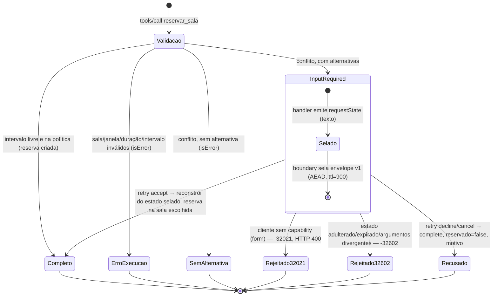

# Design

## Context

A fase 1 já entrega o servidor MCP em Streamable HTTP stateless (`/mcp`, porta 7301) com as três tools, o resource e as validações de política em `controllers/salas.py`, usando o lowlevel `Server` do SDK `mcp>=2.3,<3` (`on_list_tools`, `on_call_tool`, `on_list_resources`, `on_read_resource`). O que falta é o ciclo MRTR na tool de reserva: hoje o conflito com alternativas não reserva nada. Esta fase adiciona o `input_required` com elicitation e o `requestState` selado, usando os utilitários que o próprio SDK já oferece — o trabalho pesado (selar/abrir, expiração, digest dos argumentos) vem pronto; o que se constrói é a costura entre handler, boundary e regra de negócio.

## Goals / Non-Goals

**Goals:**

- Fazer `reservar_sala` devolver `input_required` no conflito com alternativas, com `requestedSchema` plano e `enum` na ordem fechada.
- Selar o `requestState` com `RequestStateBoundary`/`RequestStateSecurity`, chave de env, `ttl=900`, sobrevivendo a restart.
- Rejeitar `-32021` (sem capability) e `-32602` (estado inválido) sem engolir os erros do SDK.
- Concluir o retry (`accept`) e a recusa (`decline`/`cancel`) com a semântica exata do enunciado.

**Non-Goals:**

- Nada do agente A2A: sem Task, sem pausa, sem ponte. Esta fase é só o lado servidor MCP.
- Nenhuma mudança nas mensagens de erro da fase 1 nem nas validações de política existentes.
- Nenhuma persistência em disco das reservas; nenhuma sessão ou estado em memória entre `input_required` e retry.

## Decisions

### 1. Boundary do SDK, não um codec próprio

Usar `RequestStateBoundary(security, default_audience="servidor-mcp")` registrado em `Server.middleware`, com `RequestStateSecurity(keys=[os.environ["REQUEST_STATE_SECRET"]], ttl=900)`. O boundary sela o `request_state` que o handler devolve e, no retry, **verifica e abre antes do handler** — o handler recebe `params["request_state"]` como o texto claro que ele mesmo devolveu.

*Alternativas consideradas:* cifrar/assinar à mão com HMAC + base64. Descartada: o enunciado exige assinatura e o SDK já entrega AEAD (AES-256-GCM, chave derivada por HKDF-SHA256), expiração e digest dos argumentos — reimplementar só adiciona superfície de erro e risco de o validador reprovar a integridade.

### 2. O que viaja dentro do requestState

O handler serializa em `request_state` o **pedido original** (`sala`, `inicio`, `fim`, `responsavel`) e as **alternativas calculadas**. Isso é o texto que o boundary sela. No retry, o handler lê esse texto claro e reconstrói o pedido **a partir dele**, ignorando `params.arguments` reenviados (que não são confiáveis). Assim a regra "argumento adulterado não toma efeito" é satisfeita por construção, além do digest que o próprio envelope carrega.

*Alternativas consideradas:* confiar nos `arguments` do retry. Descartada: o validador (PASS 18) envia argumentos adulterados e exige que eles não tomem efeito.

### 3. Onde a regra de alternativas vive

A regra continua em `controllers/salas.py`: dada a sala pedida e o intervalo, devolve a lista de alternativas (livres, capacidade ≥ a pedida, no máximo três, ordenadas por capacidade crescente e, em empate, por `id` alfabético). O handler de `views/` só traduz: se há alternativas → monta `ElicitRequestFormParams` com `requestedSchema` plano e `enum` na ordem devolvida pelo controller, e emite `InputRequiredResult`; se não há → mantém o `isError` já existente da fase 1.

*Alternativas consideradas:* mover o cálculo para `views/`. Descartada: o enunciado é explícito que a regra de negócio fica no controller e o handler só traduz protocolo.

### 4. Falha na subida por chave ausente/curta

A leitura de `REQUEST_STATE_SECRET` acontece na inicialização, antes de montar o app. Se ausente, ou se `len < 32`, o processo imprime mensagem clara e sai com código não-zero, **antes** de ficar escutando. Nenhum valor default ou fallback no código.

*Alternativas consideradas:* usar um segredo de desenvolvimento hardcoded com aviso. Descartada: repositório público, e o critério exige que não haja segredo no código.

### 5. Erros de protocolo não são engolidos

Para `-32021` e `-32602`, o handler **não captura** a exceção do SDK: o `MCPError` (ou a rejeição do boundary) propaga e o transporte devolve o `error` JSON-RPC. O HTTP `400` é garantido por um middleware ASGI que intercepta `http.response.start`, bufferiza o corpo e reescreve o status para `400` quando o JSON-RPC traz `error.code` em `-32021`/`-32602`.

*Alternativas consideradas:* capturar e re-emitir manualmente. Descartada: risco de transformar erro de protocolo em `isError` de execução, o que reprova os PASS 15 e 17.

## Diagrama de componentes

```mermaid
flowchart LR
    subgraph Cliente MCP
        CL[Cliente / validador]
    end

    subgraph "servidor-mcp (porta 7301)"
        MV["views/ — Streamable HTTP + handlers lowlevel"]
        GM["GuardaMetaMiddleware (ASGI)\n_meta obrigatório + HTTP 400 para -32021/-32602"]
        RS["RequestStateBoundary (Server.middleware)\nsela no retorno · verifica/abre no retry"]
        HD["handler on_call_tool\n(traduz protocolo)"]
        CT["controllers/salas.py\nregra de negócio + alternativas"]
        MD["models/ — schemas e estado em memória"]
        DD[("dados/salas.json\n+ reservas.json\n(somente leitura)")]
        ENV[("REQUEST_STATE_SECRET\n(ambiente, ≥32 bytes)")]
    end

    CL -->|tools/call (reservar_sala)| MV
    MV --> GM --> RS --> HD
    HD --> CT --> MD
    CT --> DD
    RS -->|RequestStateSecurity keys| ENV
    HD -->|InputRequiredResult / CallToolResult| RS
```

- **Selagem do `requestState`**: no `RequestStateBoundary`, quando o handler devolve `InputRequiredResult` com `request_state` em texto — o envelope `v1.…` (com `v, iat, exp, m, t, a, s`) é gerado ali, com AES-256-GCM e a chave de `REQUEST_STATE_SECRET`.
- **Verificação do `requestState`**: no mesmo boundary, **antes** do handler, no request de retry; adulteração, expiração, método/target divergente ou digest de argumentos divergente levantam a rejeição `-32602` que o handler não engole.
- **Regra de alternativas**: em `controllers/salas.py`; o handler apenas traduz o resultado do controller em `ElicitRequestFormParams`/`InputRequiredResult`.

## Diagrama de estados do ciclo MRTR (um pedido de reserva)



## Risks / Trade-offs

- **[`RequestStateBoundary` importa nomes que podem divergir entre versões do SDK]** → Confirmar cada assinatura com `.venv/bin/python -c "import mcp; ..."` antes de escrever o handler (o doc `docs/sdk-mcp-2.3.0.md` lista os nomes verificados na 2.3.0); não tentar ler o site-packages.
- **[O digest de argumentos do envelope pode rejeitar retries com `arguments` ligeiramente diferentes, mesmo legítimos]** → O validador (PASS 18) envia argumentos adulterados de propósito; garantir que o handler reconstrói do estado selado e que a rejeição `-32602` propaga, em vez de tentar "afrouxar" a verificação.
- **[Chave de env esquecida quebra a subida em ambiente limpo]** → É o comportamento desejado e documentado; o README orienta `python3 -c "import secrets; print(secrets.token_hex(32))"` e export, sem nunca fixar o valor.
- **[HTTP 400 depende de middleware próprio]** → O SDK decide o status; o middleware que bufferiza `http.response.start` é o ponto único que reescreve `400` para `-32021`/`-32602`. Cobrir com o curl de verificação do validador.

## Open Questions

Nenhuma. As decisões que restavam (chave de env, onde vive a regra de alternativas, reconstrói do estado selado) foram resolvidas acima e não mudam specs, abordagem nem tarefas.
