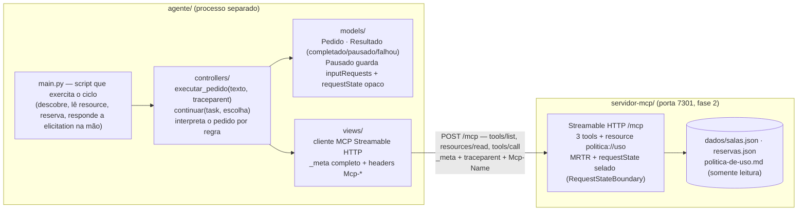
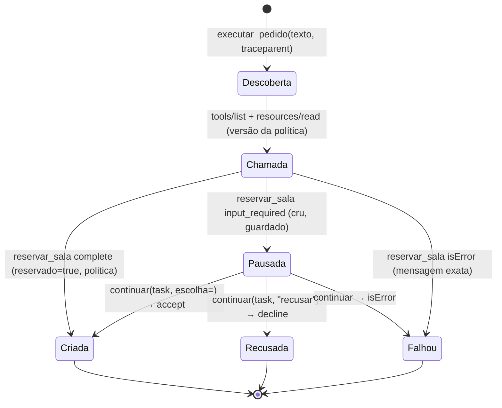

# Design

## Context

As fases 1 e 2 entregaram o `servidor-mcp` completo: Streamable HTTP stateless em `http://127.0.0.1:7301/mcp`, três tools, resource `politica://uso`, e o ciclo MRTR (`input_required` com elicitation form mode + `requestState` selado por `RequestStateBoundary`, `ttl=900`). A motivação desta fase está em `proposal.md — Why`. O que falta é o **consumidor**: um processo separado que seja host MCP de verdade — descobrindo as tools, lendo o resource e percorrendo o ciclo MRTR como cliente — exposto como biblioteca para as fases seguintes. Nesta fase o agente **não** tem servidor A2A: a superfície HTTP para fora (card, `SendMessage`, `GetTask`) e a máquina de estados da Task são fase 4, e a ponte é fase 5.

## Goals / Non-Goals

**Goals:**

- Um cliente MCP determinístico que emite `tools/list`, `resources/read` e `tools/call` com `_meta` completo e headers `Mcp-*` espelhados, sem catálogo hardcoded e sem auto-responder elicitation.
- Uma biblioteca interna (`controllers/`) com `executar_pedido(texto, traceparent)` e `continuar(task, escolha)` devolvendo um resultado tipado (`completado`/`pausado`/`falhou`), pronta para a fase 4 plugar.
- O `requestState` tratado como opaco em toda a extensão do código do agente.

**Non-Goals:**

- Nenhuma regra de negócio de sala no agente: conflito, política e alternativas são do servidor MCP.
- Nenhuma superfície A2A (card, `SendMessage`, `GetTask`) e nenhuma máquina de estados de Task — fase 4/5.
- Nenhuma interpretação semântica do `inputRequests` além da chave mecânica necessária para montar `inputResponses`.

## Decisions

### 1. Cliente MCP: `ClientSession` do SDK com `allow_input_required=True`

O agente usa o **cliente oficial do SDK** (`mcp.client.streamable_http.streamable_http_client` +
`mcp.client.session.ClientSession`). O ponto que resolve o desafio está na assinatura, verificada na
versão instalada:

```python
ClientSession.call_tool(name, arguments, *, input_responses=None, request_state=None,
                        meta=None, allow_input_required=False, ...)
    -> CallToolResult | InputRequiredResult | Result
```

Com `allow_input_required=True` o SDK **não** roda o driver de MRTR: devolve o `InputRequiredResult`
cru, que é exatamente o que o agente precisa enxergar para pausar a Task. Sem essa flag, o cliente
consumiria a pausa sozinho (seja rodando o driver, seja por callback de elicitation) e o ciclo
fecharia sem nunca voltar ao cliente A2A.

O `_meta` também é suportado: `RequestParamsMeta` é um `TypedDict` **aberto** ("arbitrary keys
round-trip via extra_items=Any"), então `traceparent` viaja junto dos campos reservados
`io.modelcontextprotocol/*` sem gambiarra.

*Risco conhecido e plano B:* os headers `Mcp-Method` e `Mcp-Name` são por request, e o transporte do
SDK monta headers por mensagem via `ctx.metadata.headers`. Se não for possível injetá-los pelo caminho
público, o fallback é passar um `http_client` próprio que acrescenta os dois headers lendo o corpo
JSON-RPC — mantendo `ClientSession` para o resto. Só se **nenhum** dos dois caminhos funcionar é que se
cai para um transporte HTTP fino com `mcp.types`; nesse caso o README documenta a limitação com o
trecho de evidência, como o enunciado permite.

*Alternativas consideradas:* transporte fino sobre HTTP desde o início (descartada: reimplementa
JSON-RPC, SSE e sessão sem necessidade, e enfraquece o requisito de usar o SDK oficial); callback de
elicitation (descartada: fecha o ciclo sozinho e evapora a pausa).

### 2. O que o resultado "pausa" guarda

O resultado `pausado` guarda: o `inputRequests` cru (o dict inteiro, sem abrir a semântica), o `requestState` opaco (string, nunca examinada) e o **pedido original** (`sala`, `inicio`, `fim`, `responsavel`), necessário para refazer o `tools/call` no retry. A única leitura mecânica que o agente faz do `inputRequests` é pegar a **chave única** (o contrato garante uma entrada) para montar o `inputResponses` com a mesma chave — não é interpretação, é o eco que o protocolo exige.

*Alternativas consideradas:* tentar re-derivar a chave ou reconstruir o `requestState`. Descartada: o `requestState` é opaco por restrição não negociável, e a chave do `inputRequests` é atribuída pelo servidor — só pode ser devolvida ecoando o que veio.

### 3. Interpretação do pedido por regra

O pedido fixo `reservar sala=<id> inicio=<iso8601> fim=<iso8601> responsavel=<nome>` é interpretado por um parser determinístico (regex sobre os quatro campos `chave=valor`), sem LLM e sem rede neural. O resultado é um objeto `Pedido` com os quatro campos tipados.

*Alternativas consideradas:* qualquer caminho de LLM. Descartada: proibido por restrição não negociável e pelo critério de determinismo (PASS 36).

### 4. A versão da política vem do resource, não da tool

A versão (`versao: <valor>`, primeira linha de `politica://uso`) é lida **uma vez** pelo agente (com cache no objeto cliente vivo) e usada como o campo `politica` do resultado de reserva concluída. A tool `reservar_sala` também devolve `politica` no `structuredContent`, mas o agente usa a versão que ele próprio leu do resource, como manda o README §3.

*Alternativas consideradas:* confiar no `politica` do `structuredContent` da tool. Descartada: o enunciado exige que o agente leia o resource e extraia a versão da primeira linha; o campo do artifact tem que refletir essa leitura.

### 5. Resultado tipado

O resultado é um tipo discriminado com três formas: `completado` (reserva criada, com `reservado=true`, `politica` e os dados da reserva — e, para recusa, `reservado=false` com `motivo`), `pausado` (o `input_required` cru) e `falhou` (a mensagem exata da tool). A recusa do `continuar(..., "recusar")` devolve um `completado` com `reservado=false` (o servidor devolve `resultType=complete` com `reservado=false`), que a fase 5 mapeará para `TASK_STATE_CANCELED`.

*Alternativas consideradas:* um quarto estado "recusado". Descartada: no wire, `decline`/`cancel` é um `complete` com `reservado=false`; manter um único estado `completado` com o flag reflete fielmente o protocolo e deixa o mapeamento da fase 5 trivial.

### 6. Propagação do traceparent

`executar_pedido(texto, traceparent)` recebe o `traceparent` da chamada de entrada e o propaga no `_meta` de **todos** os requests MCP daquela execução: o **trace-id é preservado** e o **span-id pode ser novo** (gerado por `secrets.token_hex(8)`), na forma `00-<trace-id>-<span-id>-01`. Sem `traceparent` de entrada, o campo é omitido (nada de inventar um trace-id).

*Alternativas consideradas:* gerar um trace-id novo. Descartada: o avaliador confere no stderr do servidor MCP o **mesmo trace-id** que o validador imprimiu no header A2A; o span-id pode mudar, o trace-id não.

### 7. Estado: objeto cliente vivo, sem estado de protocolo

O agente mantém **um objeto cliente vivo** (o transporte HTTP e o cache da versão da política) entre chamadas — o README diz que isso é normal e recomendado. Nenhuma sessão nem estado de protocolo é inferido entre requests: cada request carrega seu próprio `_meta`, e nada de "lembrar" a capability ou a versão de um request anterior.

*Alternativas consideradas:* recriar o cliente a cada pedido. Descartada: ineficiente e desnecessária; a restrição "nada de sessão" é sobre estado de protocolo, não sobre manter o objeto de transporte.

## Diagrama de componentes



- **Selagem/verificação do `requestState`:** acontece **inteiramente no servidor MCP** (`RequestStateBoundary` da fase 2, com `RequestStateSecurity`). O agente **nunca** toca nisso: ele recebe o valor opaco e o guarda/ecoa. Não há selagem nem verificação no agente — há apenas a regra de nunca abrir.
- **Onde "pausa":** nesta fase não há Task A2A. A pausa é representada pelo resultado `pausado`, que guarda o `input_required` cru. A pausa da Task (`TASK_STATE_INPUT_REQUIRED`) é fase 5, quando o `requestState` ficará amarrado ao `taskId`.

## Diagrama de estados do ciclo de reserva (o resultado tipado do agente)



*Nota:* a máquina de estados da **Task A2A** (`SUBMITTED` → `WORKING` → `COMPLETED`/`CANCELED`/`FAILED`/`INPUT_REQUIRED`) é da fase 4/5, não desta fase. O diagrama acima modela apenas os estados do resultado tipado que a biblioteca interna expõe.

## Risks / Trade-offs

- **[Transporte fino pode divergir do SDK em detalhes do wire (ex.: `cacheScope`, `resultType`, formato do `structuredContent`)]** → Serializar com `mcp.types` e validar cada resposta contra `exemplos/wire/`; a primeira tarefa de implementação confirma as assinaturas reais com `.venv/bin/python -c` (mesma técnica da fase 2), sem ler site-packages.
- **[O campo customizado `traceparent` no `_meta` pode não ser aceito pelo servidor se o guard do `_meta` for estrito]** → O guard do servidor exige `protocolVersion` e `clientCapabilities`; o `traceparent` é um campo adicional que o próprio validador já envia (ver `validar.py`), então é compatível. Conferir no stderr.
- **[Auto-responder a elicitation por engano fecharia o ciclo sem pausar]** → O cliente fino não registra callback de elicitation; ele devolve o `InputRequiredResult` cru para o controller, que o transforma em `pausado`.
- **[Extrair a chave do `inputRequests` sem "interpretar" é uma linha tênue]** → Documentar (decisão 2) que a única leitura é a chave única exigida pelo eco do protocolo; o restante do `inputRequests` e todo o `requestState` permanecem opacos.
- **[Reservas em memória do servidor mudam o resultado entre execuções]** → Sempre medir com o servidor recém-iniciado (mesma nota da fase 2); o determinismo do agente (PASS 36) é medido sobre o mesmo estado inicial.

## Open Questions

Nenhuma. As decisões que restavam (transporte fino vs. `ClientSession`, onde fica a versão da política, como modelar a recusa, como propagar o `traceparent`) foram resolvidas acima e não mudam specs, abordagem nem tarefas.
