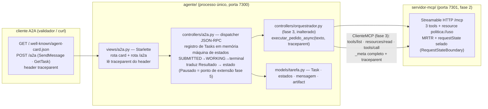
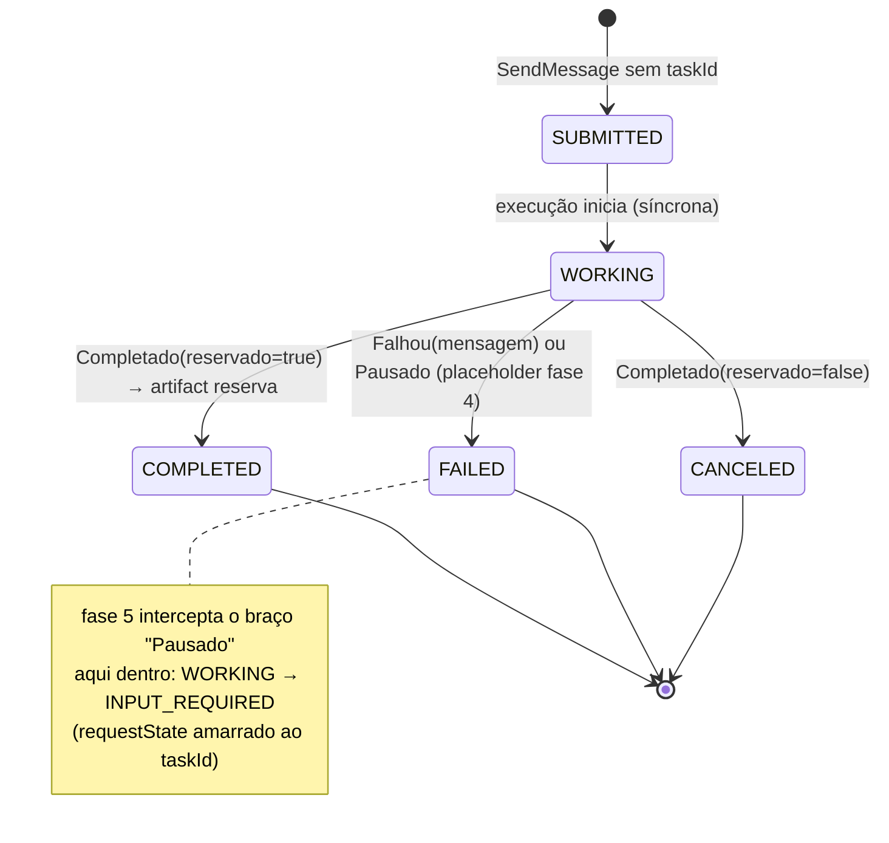

# Design

## Context

A fase 3 deixou pronta a biblioteca interna do agente: `agente/controllers/orquestrador.py` expõe `executar_pedido_async(texto, traceparent) -> Resultado` e `continuar_async(task, escolha)`, devolvendo o tipo discriminado `Completado | Pausado | Falhou` (`agente/models/pedido.py`), com `requestState` opaco e `traceparent` propagado ao `_meta` do MCP (`agente/views/cliente.py`). O servidor MCP (fases 1 e 2) está completo em `http://127.0.0.1:7301/mcp`. O que falta — motivação em `proposal.md — Why` — é a superfície A2A: card, `SendMessage`, `GetTask` e a máquina de estados da Task na porta 7300. A ponte (pausa `TASK_STATE_INPUT_REQUIRED`) é fase 5; esta fase deixa o ponto de extensão marcado.

## Goals / Non-Goals

**Goals:**

- Um servidor A2A v1.0 determinístico, no mesmo processo do agente, que reaproveita o orquestrador da fase 3 como profundidade e expõe card + `SendMessage` + `GetTask`.
- Uma máquina de estados de Task com `SUBMITTED` → `WORKING` → terminal, terminalidade definitiva e artifact `reserva`.
- Um ponto de extensão explícito onde a fase 5 intercepta o resultado `pausado`.

**Non-Goals:**

- Nenhuma regra de negócio de sala no agente — conflito, política e alternativas são do servidor MCP.
- Nenhuma pausa (`TASK_STATE_INPUT_REQUIRED`), nenhuma linha `alternativas:`, nenhum `escolha=` — fase 5.
- Nenhuma persistência de Task em disco: o registro de Tasks é em memória do processo, como as reservas (o `requestState` continua a exceção — viaja selado no servidor MCP, não aqui).

## Decisions

### 1. Transporte A2A: Starlette + uvicorn (não FastAPI)

O enunciado manda usar "FastAPI/Starlette/uvicorn, o que já estiver disponível". O ambiente traz `starlette` (1.10.0) e `uvicorn` (0.54.0) como dependências do SDK `mcp`, mas **não** traz `fastapi`. Portanto o servidor é construído direto com `Starlette` (`Starlette(routes=[...])`) servido por `uvicorn`, sem adicionar dependência nova.

*Alternativas consideradas:* adicionar `fastapi` ao `pyproject.toml`. Descartada: introduz uma dependência desnecessária quando `starlette` já cobre as duas rotas (`GET /.well-known/agent-card.json` e `POST /a2a`) sem modelagem de request body que justifique o FastAPI.

### 2. Registro de Tasks em memória, idempotente por id

Um dicionário `dict[str, Task]` em memória guarda as Tasks pelo `id`. Os ids seguem o formato dos exemplos de wire (`task-<hex12>`, `ctx-<hex12>`, `msg-<hex12>`), gerados com `secrets.token_hex(6)`. Nada é persistido: um restart zera o registro, coerente com "persistência de reservas pode ser em memória". O `requestState` **não** vive aqui — na fase 5 ele será amarrado à Task, mas hoje ele nem chega a ser guardado porque a pausa não existe (ver decisão 5).

*Alternativas consideradas:* banco ou arquivo para as Tasks. Descartada: fora de escopo (sem ORM, sem camada de serviços) e desnecessário para o validador, que roda com processos recém-iniciados.

### 3. Dispatcher JSON-RPC em `controllers/a2a.py`

A rota `POST /a2a` faz o mínimo: lê o corpo JSON, extrai `method`, `id` e `params`, e despacha para um controlador que conhece a máquina de estados. O controlador:

- **`SendMessage`**: extrai o texto do pedido de `params.message.parts[*].text` (e o `traceparent` do header HTTP). Se `params.message.taskId` não vier, abre Task nova (decisão 4); se vier, consulta o registro e recusa Task terminal (decisão 6) ou inexistente.
- **`GetTask`**: lê `params.id`, devolve a Task registrada (ou erro JSON-RPC se não existir).

O `id` do JSON-RPC é ecoado byte a byte (string ou número) na resposta — o validador usa `secrets.token_hex(6)` como id e compara.

*Alternativas consideradas:* roteamento declarativo por `method` com reflection. Descartada: dois métodos só; um `if/elif` explícito é mais legível e determinístico.

### 4. Abertura e transição da Task

`SendMessage` sem `taskId` cria a Task em `TASK_STATE_SUBMITTED` (com `id` e `contextId` próprios), acrescenta a mensagem do usuário ao `history`, transita para `TASK_STATE_WORKING`, chama `executar_pedido_async(texto, traceparent)` e traduz o resultado para o estado terminal (decisão 5). Como a execução é **síncrona** (o orquestrador espera a resposta MCP), `SUBMITTED` e `WORKING` são estados transitórios internos — a resposta do `SendMessage` já devolve a Task terminal. O `GetTask` reflete o estado corrente a qualquer momento, que no fluxo síncrono é o terminal.

### 5. Tradução `Resultado` → estado da Task, e o ponto de extensão da fase 5

O núcleo da tradução é uma função única `_traduzir(resultado) -> (estado, mensagem, artifact | None)` no controlador A2A:

| `Resultado` (fase 3) | Estado da Task (fase 4) | Mensagem de status | Artifact |
|---|---|---|---|
| `Completado(reservado=True)` | `TASK_STATE_COMPLETED` | `Reserva {reserva} confirmada na {sala}.` | `reserva` (JSON da reserva) |
| `Completado(reservado=False)` | `TASK_STATE_CANCELED` | texto da recusa | — |
| `Falhou(mensagem)` | `TASK_STATE_FAILED` | a `mensagem` exata da tool | — |
| `Pausado(...)` | `TASK_STATE_FAILED` *(placeholder)* | mensagem determinística | — |

**Ponto de extensão da fase 5** — o caso `Pausado` é o único lugar onde a fase 5 vai mexer na máquina de estados. Nesta fase ele vira `TASK_STATE_FAILED` com uma mensagem fixa (o conflito ainda não pausa); na fase 5, esse mesmo braço passa a produzir `TASK_STATE_INPUT_REQUIRED`, montar a linha `alternativas: <ids>` a partir do `enum` da elicitation e amarrar o `requestState` (já carregado no `Pausado`) ao `id` da Task — sem tocar no resto do controlador. O `Pausado` da fase 3 já guarda `input_requests` e `request_state` crus, então a fase 5 não precisa reler o MCP.

O artifact `reserva` é um objeto com `artifactId` próprio e `parts[0].text` igual ao JSON com exatamente as chaves `reserva`, `sala`, `inicio`, `fim`, `responsavel`, `politica` (a versão lida do resource, já presente no `Completado.politica` da fase 3).

### 6. Terminalidade definitiva e erro JSON-RPC

Se `SendMessage` referenciar uma Task cujo estado está em `{COMPLETED, FAILED, CANCELED}`, o controlador devolve um **erro JSON-RPC** (`{"jsonrpc": "2.0", "id": <id>, "error": {...}}`, sem `result`) — código e mensagem determinísticos (ex.: `-32000` / "Task <id> is in terminal state <estado>"). O validador (PASS 31) só exige a presença do campo `error`; a Task **não** volta a `WORKING`.

### 7. Propagação do traceparent

A rota `POST /a2a` lê o header `traceparent` da request HTTP e o repassa a `executar_pedido_async(texto, traceparent=...)`. O orquestrador da fase 3 já propaga o mesmo trace-id (span-id novo) no `_meta` de todos os requests MCP. Sem header, `traceparent` é `None` e o campo é omitido no MCP — nada de inventar trace-id.

### 8. Agent Card estático

O card é um dict Python espelhando `exemplos/wire/07-a2a-agent-card.json`: `name`, `description`, `provider`, `version` (`1.0.0`), `supportedInterfaces` (uma entrada com `url` do `/a2a`, `protocolBinding: "JSONRPC"`, `protocolVersion: "1.0"`), `capabilities` (`streaming: false`, `pushNotifications: false`, `extendedAgentCard: false`), `defaultInputModes`/`defaultOutputModes` (`text/plain`) e a skill `reservar-sala`. A `url` do endpoint é derivada da configuração de host/porta (default `http://127.0.0.1:7300/a2a`), para que o card bata com o endpoint real.

## Diagrama de componentes

- **Selagem/verificação do `requestState`:** acontece **inteiramente no servidor MCP** (`RequestStateBoundary` da fase 2, AES-256-GCM via `RequestStateSecurity`, `ttl=900`). O agente **nunca** toca nisso: recebe o valor opaco no `Pausado` e o guarda/ecoa. Não há selagem nem verificação no agente — há apenas a regra de nunca abrir (já garantida na fase 3).
- **Onde a Task pausa:** nesta fase, **não pausa** — o `Pausado` vira `TASK_STATE_FAILED` (decisão 5). A pausa real (`TASK_STATE_INPUT_REQUIRED` + `requestState` amarrado ao `taskId`) é a fase 5, e o ponto de extensão é o braço `Pausado` da tradução, já isolado para isso.

## Diagrama de estados da Task A2A

*Nota:* o estado `TASK_STATE_INPUT_REQUIRED` (e a transição a partir de `Pausado`) é da fase 5; aparece apenas na nota para marcar onde a ponte entra. Nesta fase o desfecho de um conflito é `FAILED`, e qualquer `SendMessage` que referencie um estado terminal é recusado com erro JSON-RPC (não há aresta de volta para `WORKING`).

## Risks / Trade-offs

- **[A execução síncrona torna `SUBMITTED`/`WORKING` inobserváveis por `GetTask`]** → Isso é aceitável: o validador só observa o estado terminal (PASS 24–26). O estado corrente é registrado no modelo antes de cada transição, então um `GetTask` concorrente (se houvesse) veria o estado intermediário. O README documenta que o agente executa o pedido de forma síncrona.
- **[`Pausado` virando `FAILED` é deliberadamente temporário]** → O braço `Pausado` fica isolado e documentado como ponto de extensão; a fase 5 troca apenas esse braço, sem reescrever o dispatcher. O texto da mensagem placeholder é fixo e determinístico.
- **[Conflito de `sala-garagem` em checks 27–30 vai falhar nesta fase]** → Esperado: esses PASS pertencem à ponte (fase 5). O gate desta fase é medido em 21–26, 31 e 35, e PASS 01–20 seguem verdes.
- **[Formato exato do wire (ids, campos do card, JSON do artifact) é fácil de errar]** → Serializar contra `exemplos/wire/07` e `10`, e medir com o validador; os nomes de estado e a chave `name: "reserva"` são conferidos byte a byte.
- **[Header `traceparent` pode se perder entre a rota e o orquestrador]** → Passar o header como argumento explícito (não via estado global), e conferir no stderr do servidor MCP o trace-id do validador.

## Open Questions

Nenhuma. As decisões que restavam (Starlette vs. FastAPI, onde fica o registro de Tasks, como modelar a terminalidade, onde a fase 5 intercepta o `Pausado`) foram resolvidas acima e não mudam specs, abordagem nem tarefas.
