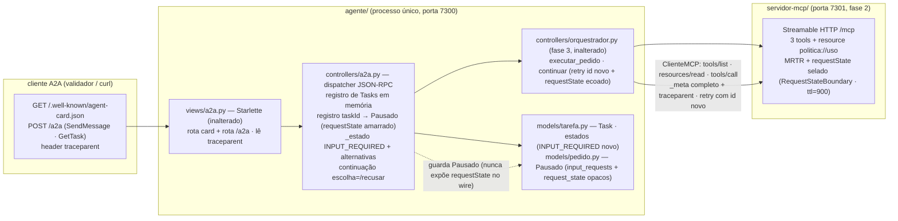
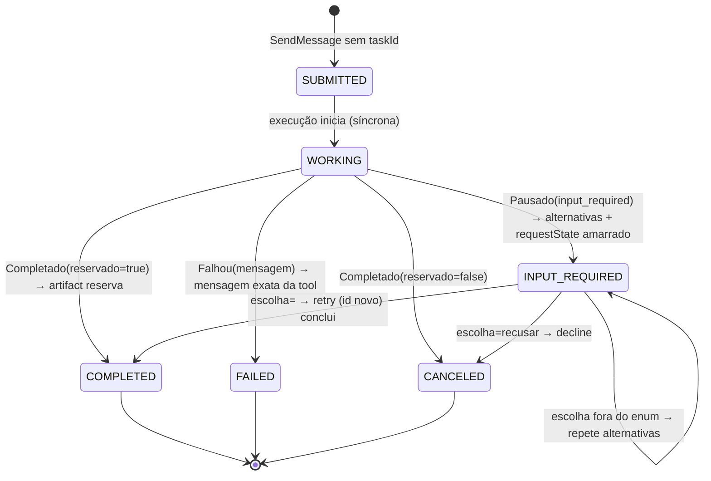

# Design

## Context

A fase 4 deixou o servidor A2A completo, exceto o braço `Pausado` — que hoje termina a Task em `TASK_STATE_FAILED` com um placeholder. O orquestrador da fase 3 (`agente/controllers/orquestrador.py`) já resolve a profundidade: `executar_pedido(texto, traceparent)` devolve `Completado | Pausado | Falhou`, e `continuar(task: Pausado, escolha)` já refaz o `tools/call` com id JSON-RPC novo (o SDK gera um id por `send_request`), `inputResponses` com a **mesma chave** do `inputRequests` e o `requestState` ecoado byte a byte, traduzindo `recusar` → `decline`. O `Pausado` (`agente/models/pedido.py`) já guarda `input_requests`, `request_state`, `pedido`, `versao_politica` e `traceparent`. Ou seja: toda a mecânica do retry existe; o que falta é o controlador A2A **segurar o `Pausado` amarrado ao `taskId`** e expor a pausa/retomada no wire. A motivação está em `proposal.md — Why`.

## Goals / Non-Goals

**Goals:**

- Fechar a ponte apenas no controlador A2A: pausa `TASK_STATE_INPUT_REQUIRED` + linha `alternativas: <ids>` + registro `taskId → Pausado` + continuação `escolha=`.
- Reaproveitar `continuar` da fase 3 sem alteração (o retry com id novo e `requestState` ecoado já está pronto).

**Non-Goals:**

- Nenhuma regra de negócio de sala, nenhuma leitura do conteúdo do `requestState`, nenhuma persistência de Task em disco.
- Não tocar no `servidor-mcp/` (o MRTR e a selagem do `requestState` continuam inteiramente lá).

## Decisions

### 1. `EstadoTask.INPUT_REQUIRED` fora de `ESTADOS_TERMINAIS`

`agente/models/tarefa.py` ganha `INPUT_REQUIRED = "TASK_STATE_INPUT_REQUIRED"`. O estado **não** entra em `ESTADOS_TERMINAIS`, então `Task.eh_terminal()` devolve `False` para uma Task pausada — o ramo de continuação de `_send_message` (hoje `raise ... fase 5`) passa a aceitar a Task e retomar. `COMPLETED`, `FAILED` e `CANCELED` seguem terminais e continuam recusando `SendMessage` (PASS 31).

*Alternativas consideradas:* manter `INPUT_REQUIRED` como flag à parte da máquina de estados. Descartada: o validador lê `status.state` como `TASK_STATE_INPUT_REQUIRED`, então o estado precisa ser um valor legítimo do enum e não-terminal.

### 2. Registro `taskId → Pausado` em memória

Um novo dicionário `self._pausas: dict[str, Pausado]` no `ControladorA2A` guarda, no momento da pausa, o `Pausado` inteiro indexado pelo `taskId`. É o **único** lugar onde o `requestState` vive no agente, e ele nunca é serializado: `Task.para_dict()` não conhece `Pausado`, e nenhum caminho copia o `request_state` para uma mensagem, artifact ou card. A chave é o `taskId` (a Task já registrada em `self._tarefas`), o que garante o isolamento por Task (PASS 33): cada continuação lê `self._pausas[task_id]` e usa aquele `Pausado`, sem globais compartilhados.

*Alternativas consideradas:* (a) guardar o `Pausado` dentro do dataclass `Task`. Descartada: `Task.para_dict()` serializaria os campos do `Pausado` se alguém esquecer de filtrar, aumentando o risco de vazar o `requestState`; um dict separado torna o não-vazamento estrutural. (b) guardar só `request_state`. Insuficiente: a continuação precisa também de `input_requests` (chave + `enum`) e do `pedido` para o retry — tudo já junto no `Pausado`.

### 3. Extração do `enum` para a linha `alternativas:` e a validação da escolha

A única leitura "não-opaca" que o agente faz é o **`enum` visível** da elicitation, para montar a linha de alternativas e validar a escolha. O `input_requests` é `dict[str, Any]`; a chave única é obtida com `next(iter(input_requests))`, e o `enum` vem de `input_requests[chave]["params"]["requestedSchema"]["properties"]["sala"]["enum"]` (ou `const`, com uma única alternativa — o README aceita os dois). A ordem do `enum` é **preservada** na string `", ".join(enum)`, que vira a linha `alternativas: <ids>`.

O `requestState` continua **opaco**: o agente nunca o abre, interpreta nem reconstrói. A leitura do `enum` é a única introspecção, e é exatamente o que o enunciado exige para a linha de alternativas.

*Alternativas consideradas:* re-derivar o `enum` a cada continuação a partir do `Pausado` (em vez de guardar uma lista derivada). Escolhida: guardar só o `Pausado` e derivar o `enum` quando necessário (na pausa e na validação da continuação) evita um segundo campo que poderia dessincronizar; a derivação é uma função pura e barata.

### 4. Tradução `Pausado` → pausa (troca do ponto de extensão)

O braço `Pausado` de `_traduzir` deixa de devolver `(FAILED, placeholder, None)` e passa a devolver `(INPUT_REQUIRED, "alternativas: " + ", ".join(enum), None)`. A mudança é **local** a esse braço; `Completado` e `Falhou` seguem como na fase 4. Para o controlador amarrar o `Pausado` ao `taskId`, a tradução é dividida: `_abrir_e_executar` detecta `isinstance(resultado, Pausado)`, registra `self._pausas[tarefa.id] = resultado` **antes** de montar a mensagem, e então produz o status `INPUT_REQUIRED`.

### 5. Continuação no ramo `task_id is not None`

O ramo de `_send_message` que hoje lança "continuacao da fase 5" passa a:

1. recuperar a Task e conferir que está em `INPUT_REQUIRED` (e não terminal — se terminal, mantém o erro JSON-RPC atual);
2. ler `self._pausas[task_id]` (erro determinístico se não existir);
3. interpretar o texto: `escolha=<valor>` (prefixo fixo). Caso o texto não case com `escolha=`, ou o `<valor>` esteja fora do `enum`, a Task **permanece** `INPUT_REQUIRED` e a mensagem de status **repete** a linha `alternativas: <ids>` — sem chamar o MCP (PASS 29);
4. se `<valor>` for `recusar`, chamar `continuar(pausa, "recusar")` (que já produz `decline`); senão, se estiver no `enum`, chamar `continuar(pausa, valor)` (que já produz `accept` + `content={"sala": valor}`);
5. traduzir o resultado com a mesma `_traduzir` da abertura — `Completado(reservado=True)` → `COMPLETED` + artifact; `Completado(reservado=False)` → `CANCELED`; `Falhou` → `FAILED`; um `Pausado` inesperado no retry → mantém `INPUT_REQUIRED` (defensivo, não ocorre no fluxo selado);
6. registrar a mensagem do usuário (`escolha=...`) e a mensagem do agente no `history`, e o artifact quando houver.

O retry com id JSON-RPC novo é responsabilidade do `continuar` da fase 3 (o SDK gera um id por request), então a especificação "id novo" é satisfeita por construção — o design não reabre essa mecânica.

*Alternativas consideradas:* tratar a continuação como um novo `SendMessage` sem `taskId`. Descartada: sem `taskId` abriria uma Task nova e perderia o `requestState`, quebrando a ponte.

### 6. Ausência de regra de negócio

Nenhuma das decisões acima introduz regra de sala: conflito, política, cálculo de alternativas e o conteúdo selado do `requestState` são do servidor MCP. O agente só traduz `input_required` ↔ `TASK_STATE_INPUT_REQUIRED` e guarda estado nomeado (`requestState` amarrado ao `taskId`).

## Diagrama de componentes

- **Onde o `requestState` é selado e verificado:** **inteiramente no servidor MCP** (`RequestStateBoundary`, AES-256-GCM via `RequestStateSecurity`, `ttl=900`, chave de `REQUEST_STATE_SECRET`). O agente **não sela nem verifica** — ele apenas recebe o valor opaco no `Pausado`, guarda no registro `taskId → Pausado` e o ecoa no retry via `continuar`, sem nunca abrir.
- **Onde a Task pausa:** no `ControladorA2A`, no braço `Pausado` de `_traduzir` (chamado por `_abrir_e_executar`): ao ver `Pausado`, o controlador registra `self._pausas[tarefa.id] = resultado` e monta o status `TASK_STATE_INPUT_REQUIRED` com a linha `alternativas: <ids>`.

## Diagrama de estados da Task A2A

*Nota:* a aresta `INPUT_REQUIRED → INPUT_REQUIRED` é a escolha fora do `enum` (PASS 29): não há chamada ao MCP, a Task fica pausada e a mensagem repete a linha de alternativas. As arestas de retomada (`→ COMPLETED` e `→ CANCELED`) usam o `requestState` amarrado àquela Task, com id JSON-RPC novo.

## Risks / Trade-offs

- **[Vazar o `requestState` em alguma resposta A2A]** → Estrutural: `requestState` vive só em `self._pausas[task_id]`, que `Task.para_dict()` não conhece; a varredura do validador (PASS 34) confirma. Mitigação extra: revisar que nenhum `dict` derivado do `Pausado` é serializado.
- **[Dessincronizar o `enum` derivado da elicitation com o `enum` real]** → Derivar o `enum` sempre da mesma função pura, direto do `Pausado.input_requests`, tanto na pausa quanto na validação; a ordem é a do campo `enum` (ou `const`), nunca reordenada.
- **[Continuação com texto que não é `escolha=` (ou escolha fora do `enum`) bater no MCP indevidamente]** → O ramo de continuação valida o prefixo e a pertinência ao `enum` **antes** de chamar `continuar`; fora disso, mantém a pausa e repete a linha, sem tocar no MCP.
- **[Retry devolver `input_required` de novo (fluxo defensivo)]** → A tradução trata `Pausado` no retry mantendo `INPUT_REQUIRED`, em vez de cair em `TypeError`; não ocorre no fluxo selado, mas mantém o controlador total.
- **[Estado pausado compartilhado entre Tasks por engano]** → O registro é indexado por `taskId`, e cada continuação lê `self._pausas[task_id]` da própria Task; o teste de PASS 33 (duas reservas distintas) cobre o isolamento.

## Open Questions

Nenhuma. O escopo (a nota do desafio) fecha todos os desfechos: pausa com `alternativas: <ids>` na ordem do `enum`, `requestState` amarrado e nunca exposto, `escolha=` dentro/fora do `enum` e `recusar`, e estado pausado por Task. A mecânica do retry (id novo + `inputResponses` + eco do `requestState`) já está pronta no `continuar` da fase 3.
