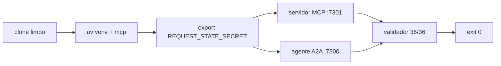

# Design

## Context

As fases 1 a 5 entregam o servidor MCP, o ciclo MRTR, o agente como host MCP, o servidor A2A e a ponte.
Falta tornar isso reproduzível por terceiros a partir do repositório.

## Decisions

### 1. README como contrato de execução, não como resumo

O README lista comandos exatos, na ordem, incluindo a geração da `REQUEST_STATE_SECRET` — o único passo que
não é óbvio e sem o qual o servidor MCP não sobe. A seção "Onde a ponte acontece" aponta arquivo e função
em cada lado da fronteira, porque é isso que o avaliador procura.

*Alternativa descartada:* manter o enunciado no README e mover a documentação para `docs/`. O enunciado
exige explicitamente a substituição.

### 2. Verificação em clone limpo, não no diretório de trabalho

O diretório de desenvolvimento tem `.venv`, processos antigos e estado em memória. A prova de entrega é
clonar o repositório para uma pasta vazia, seguir o README e rodar o validador — o mesmo caminho do
avaliador.

### 3. Portas isoladas no script de progresso

`scripts/progresso.sh` sobe os dois processos em `7391`/`7390` com segredo novo e `MCP_URL` apontando para o
servidor daquela execução. Sem isso, medir com processos antigos no ar produz falso negativo (o validador
muta o estado em memória e o agente falaria com o servidor errado).

## Diagrama do fluxo do avaliador

